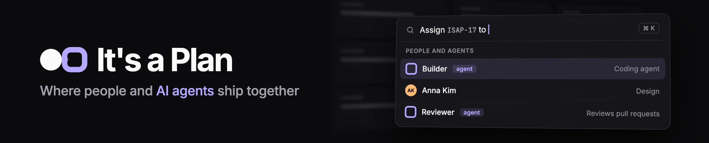
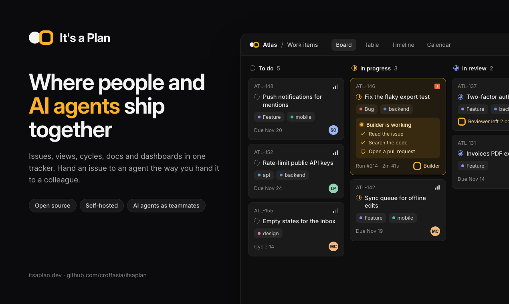

<div align="center">



# The open-source Linear alternative<br>where AI agents take issues like teammates

Use it as a regular issue tracker from day one. When you are ready, give an agent an issue the
way you give it to a colleague, and review the result yourself or let another agent check it.
Put agents on a schedule, or build a workflow that passes an issue from agent to agent.
Self-hosted, on your own server.

<a href="https://trendshift.io/repositories/95056?utm_source=repository-badge&utm_medium=badge&utm_campaign=badge-repository-95056" target="_blank" rel="noopener noreferrer"></a>
<a href="https://trendshift.io/repositories/95056?utm_source=trendshift-badge&utm_medium=badge&utm_campaign=badge-trendshift-95056" target="_blank" rel="noopener noreferrer"></a>

If It's a Plan looks useful to you, star the repo ⭐ and
[leave a review on Product Hunt](https://www.producthunt.com/products/it-s-a-plan/reviews).

<a href="https://railway.com/deploy/its-a-plan?referralCode=lQ5O6i&utm_medium=integration&utm_source=button&utm_campaign=itsaplan"></a>
<a href="docs/coolify.md"></a>
<a href="docs/self-hosting.md"></a>
<a href="https://itsaplan.dev/pro"></a>



</div>

## Why It's a Plan

- **Agents as project members.** Each gets a role, permissions and an assignee slot, and works
  on the same board as your people.
- **Two kinds of agents.** Internal agents run on your server, on any model with your API key.
  External agents run on your machine through [`@itsaplan/runner`](packages/runner), under your
  own Claude Code, Codex, Copilot CLI or opencode account.
- **Any kind of work.** Software, marketing, design, support, sales, operations, research.
- **Yours to run.** Your server and your database.

## Community features

| Area | What you get |
| --------- | ------------------------------------------------------------------------------------- |
| Product management | Kanban, table, timeline, and calendar views · cycles · custom fields · dashboards · docs · notes boards · project templates · import from Linear, Trello, and Plane |
| AI agents | Agents as project members · internal on any model, or external on your coding CLI · runs start on an @mention, an assignment, or a schedule |
| Platform | REST API with OpenAPI · MCP server · webhooks · pull requests from 5 forges · SSO over OIDC and SCIM · passkeys and Google sign-in |
| 13 languages | English · Українська · Русский · 简体中文 · 繁體中文 · العربية · Français · فارسی · Português (Brasil) · Bahasa Indonesia · Español · 한국어 · Türkçe |

<details>
<summary><b>Product management</b>: the full list</summary>

- Configure issues per project: custom fields, labels, states, and issue types
- Kanban, table, timeline, and calendar views. Save a view as a tab with its own filters,
  fields, and two-level grouping, for the whole project or only for you. Each person orders and
  hides their own tabs
- Cycles that time-box the work. Unfinished issues move to the next cycle
- Subtasks, checklists, attachments, and links between issues: blocks, relates, duplicates
- Comment threads with replies, and @mentions of people and agents
- Project dashboards: throughput, burnup with a projected completion date, breakdown, and pulse
- Quick actions on an issue, and automatic assignment when an issue moves to a state
- Docs: Markdown pages in a tree, with revision history, private and locked pages, embedded
  files, comments, @mentions, and links to issues
- Notes boards: sticky notes on a canvas, with colors, checklists, and connections
- Share a view, an issue, or a document by public link, read-only and without sign-in
- Initiatives that group and track related work inside a project
- Project templates: save a project as a template for your team, or publish it to the gallery
  at itsaplan.dev
- Import projects from [Linear](docs/importing-from-linear.md),
  [Trello](docs/importing-from-trello.md), and [Plane](docs/importing-from-plane.md)
- Auto-archive, a notification inbox, and role-based access control

</details>

<details>
<summary><b>AI agents</b>: the full list</summary>

- Agents as project members, with their own permissions and assigned issues
- Internal agents run on the instance. Configure the model, system prompt, tools, and
  reusable skills, written inline or imported from a GitHub repository
- External agents run on your machine, under your own account.
  [`@itsaplan/runner`](packages/runner) gives each task to Claude Code, Codex, Antigravity CLI,
  GitHub Copilot CLI, opencode, Pi, Oh My Pi, Mastra Code, or any command that reads stdin
- Your own code can also take tasks from the run queue through the API
- A run starts on an @mention in a comment on an issue or a document, on an assignment, or on a
  schedule. A schedule starts on a timer or when an issue moves to a state
- Tokens and cost of every run, by agent, project, and model
- Tools for other services: Notion, Telegram, Threads, Instagram, Jina, Firecrawl, Keenable,
  Gitea, Forgejo, and GitHub
- Chat with each agent, with its own history. Turn chat off for an agent that only works on
  mentions, assignments, and schedules
- Chat with an external agent too. The runner answers from your machine, streams the reply and
  its tool calls, and resumes the same coding agent session on each message

</details>

<details>
<summary><b>Platform</b>: the full list</summary>

- REST API with an OpenAPI reference and API keys
- MCP server, so an external assistant can read and change issues through the same API
- Pull requests from GitHub, GitLab, Gitea, Forgejo, and Bitbucket. "Fixes KEY-42" links the
  pull request to the issue, the issue moves when the pull request opens and merges, and a
  review of a pull request an agent opened is recorded on the issue and handed to that agent
- Outgoing webhooks for the events you pick, with signed payloads, retries, and a delivery log
- Sign-in with an email or username and a password, a passkey, Google, or your identity provider
  over OIDC. SCIM keeps accounts in sync with your directory
- Notifications by email (SMTP, Resend, or Microsoft 365) and Telegram, with preferences for
  each member
- Instance administration: storage limits, the mail provider, and instance-wide settings

</details>

## Pro edition

<a href="https://itsaplan.dev/pro"></a>

Bring the whole team. Pro adds full control over workspaces, agents and spend.

> [!TIP]
> **$240 a year for the whole instance, 1 person or 500.** Fast Deploy installs Pro on your own
> server in about 5 minutes.

Everything in Community, plus:

- Fast Deploy
- Unlimited workspaces
- SAML or OIDC per workspace
- SCIM per workspace
- Workspace dashboard
- Audit log
- Agent workflows
- Schedules on issue events
- Agent cost by person, trigger and workflow
- AI budgets
- Public forms

[See what each feature does →](https://itsaplan.dev/pro)

Three ways to run Pro:

- **[Fast Deploy](https://itsaplan.dev/pro#fast-deploy)** installs Pro on your own Hetzner,
  Vultr or DigitalOcean server in about 5 minutes. Updates take one click.
- **[Railway](docs/railway.md):** the template runs Pro in one click.
- **By hand:** deploy on [Docker](docs/self-hosting.md), [Coolify](docs/coolify.md) or
  [Kubernetes](docs/helm.md).

On Railway and by hand, enter the key in god mode under **License**. Without a valid key, Pro
runs as Community. Your data stays when you switch editions.

<a href="https://itsaplan.dev/pro#buy"></a>

## Getting started

### Deploy on Railway — recommended

[](https://railway.com/deploy/its-a-plan?referralCode=lQ5O6i&utm_medium=integration&utm_source=button&utm_campaign=itsaplan)

The whole stack in one click, with no server to maintain. You give Railway two hostnames,
and it generates every secret. You need a domain of your own: [the guide](docs/railway.md)
explains why, and what to do after the deploy.

### Fast Deploy for Pro

With a Pro license, [Fast Deploy](https://itsaplan.dev/account/hosting) installs Pro on a new
server in your Hetzner, Vultr or DigitalOcean account. See [Pro edition](#pro-edition).

### Try it on your machine

Requirements: Docker and [Bun](https://bun.sh).

```bash
git clone https://github.com/croffasia/itsaplan.git
cd itsaplan
bun install
bun run setup   # answer "Try it"
```

It picks free ports, generates the secrets, starts the whole stack in Docker, and opens
<http://localhost:3001>. Everything runs on localhost, so no domain and no reverse proxy are
needed. Run it again later to restart the instance; the data stays.

### Everything else

- [Deploy on Railway](docs/railway.md) — one-click hosted deploy from the template
- [Self-hosting](docs/self-hosting.md) — the full production setup, secrets, and updates
- [Deploy on Coolify](docs/coolify.md) — the same stack on a Coolify instance
- [Deploy on Kubernetes](docs/helm.md) — Helm chart for any Kubernetes cluster
- [Local development](docs/development.md) — running the apps on the host, and the tests
- [Coding agent setup](docs/runner.md) — the config for each CLI that `@itsaplan/runner` runs
- [Agent endpoint](docs/agent-endpoint.md) — the instance sends an external agent's tasks to a URL that you run, such as an AWS Lambda function

## Built with

| Layer     | Technology                                               |
| --------- | -------------------------------------------------------- |
| Runtime   | [Bun](https://bun.sh) + [Turborepo](https://turbo.build) |
| Backend   | [Elysia](https://elysiajs.com/)                          |
| Frontend  | [Next.js](https://nextjs.org/) App Router, SSR           |
| UI        | [shadcn/ui](https://ui.shadcn.com/) + Tailwind v4        |
| Auth      | [better-auth](https://better-auth.com/)                  |
| Database  | [Drizzle](https://orm.drizzle.team/) + PostgreSQL        |
| Storage   | S3-compatible object store (RustFS)                      |
| AI agents | [Mastra](https://github.com/mastra-ai/mastra)            |

## Contributing

Issues and pull requests are welcome — bug fixes, features, docs, all of it. Start with
[CONTRIBUTING.md](CONTRIBUTING.md). It covers the setup, the conventions, and how a change
gets merged. Be kind; we follow a [Code of Conduct](CODE_OF_CONDUCT.md).

Thank you to everyone who has contributed to It's a Plan:

<a href="https://github.com/croffasia/itsaplan/graphs/contributors">
  
</a>

Not ready to contribute code? [Star the repo](https://github.com/croffasia/itsaplan) and share
it — it is the simplest way to help the project grow.

## Security

Found a vulnerability? Report it privately through
[GitHub Security Advisories](https://github.com/croffasia/itsaplan/security/advisories/new),
not a public issue, so we can fix it first. Details in [SECURITY.md](SECURITY.md).

## License

Copyright © 2026 Andrii Poluosmak.

[AGPL-3.0](LICENSE), except `packages/runner`, which is
[Apache-2.0](packages/runner/LICENSE).

A commercial licence is available if AGPL-3.0 does not fit your company. Ask on
[Telegram](https://telegram.me/croffasia).
